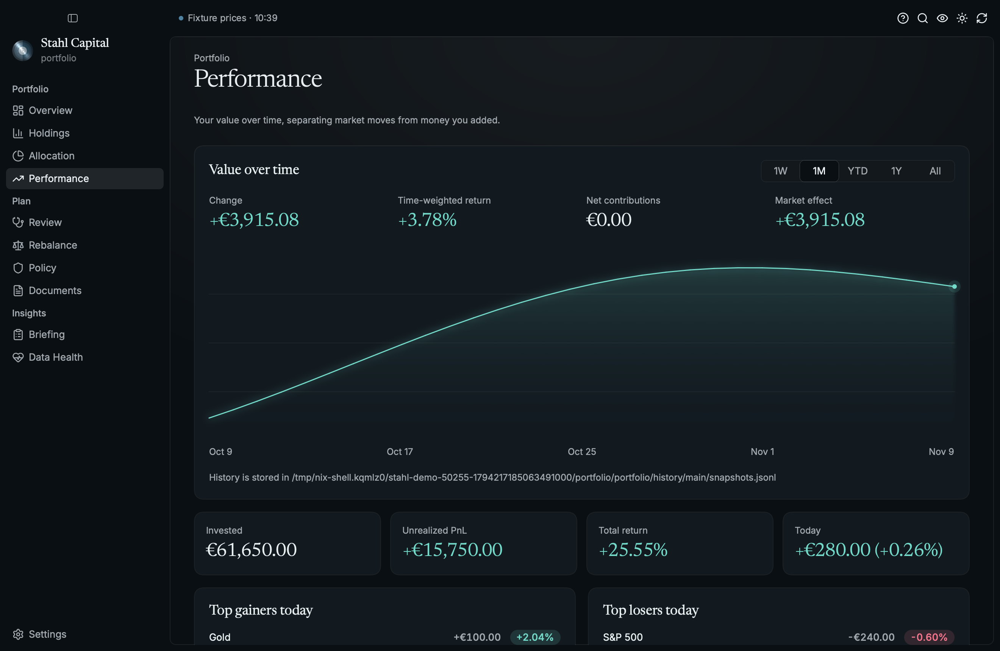
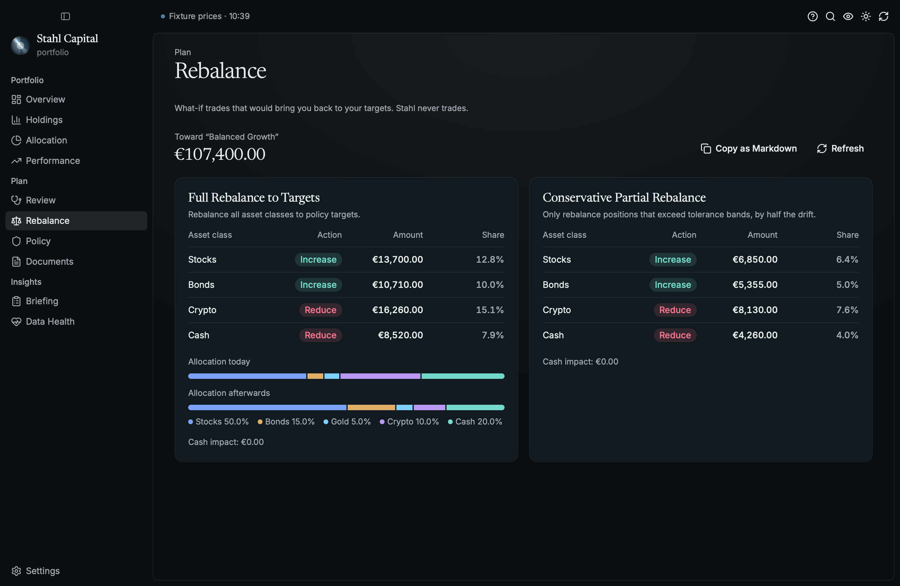
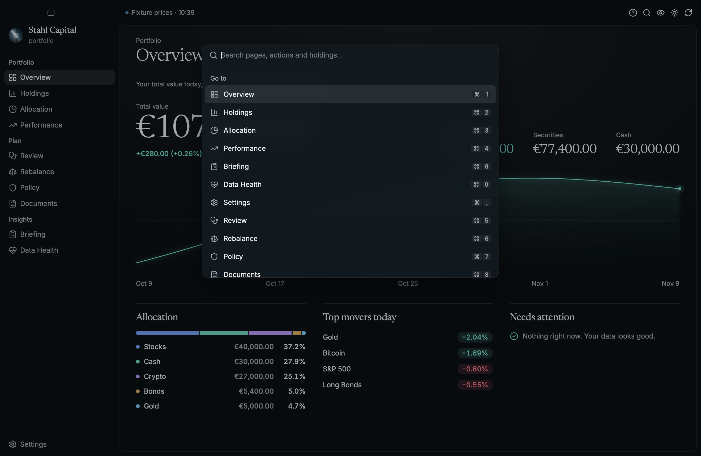
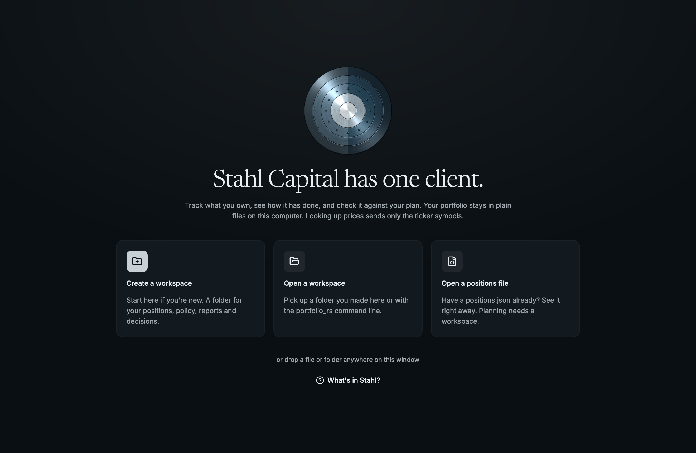
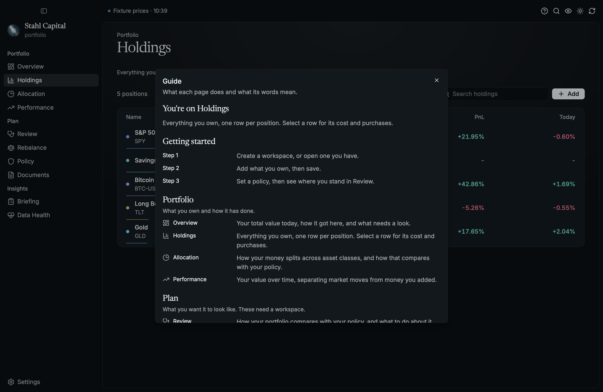

<p align="center"></p>

# Stahl Capital

[](https://github.com/MarkusZoppelt/stahl/actions/workflows/ci.yml)

A desktop app for [`portfolio_rs`](https://github.com/MarkusZoppelt/portfolio_rs). Track what you
own, see how it got there, check it against your investment policy, and try out a rebalance before
you do it. Your data stays in plain files on your machine. Written in Rust on
[Rune](https://github.com/anomalyco/rune), with no web view. Runs on macOS, Linux and Windows, and
on iPhone and iPad ([ios/](ios/README.md)).

More at [zoppelt.net/stahl](https://zoppelt.net/stahl/). It's early, so expect rough edges.


| | |
|---|---|
|  |  |
|  |  |
|  |  |

## Getting started

Install it with Nix, or grab a `.dmg`, `.deb` or Windows `.zip` from
[Releases](https://github.com/MarkusZoppelt/stahl/releases):

```sh
nix run github:MarkusZoppelt/stahl              # try it
nix profile install github:MarkusZoppelt/stahl  # keep it
```

The macOS build isn't notarized, so the first time you open it, right-click it and choose Open. On
Linux you need a Vulkan driver (`mesa-vulkan-drivers` on Debian and Ubuntu).

On first launch, create a workspace. That's a folder in the same format as
`portfolio_rs init-workspace`, with your positions, your policy and its history in it. You can also
open a single positions file (`stahl positions.json`), but Review, Rebalance, Policy and Documents
need a workspace. If you're lost, press `⌘/` for the guide, or `⌘K` for everything else (Ctrl on
Linux and Windows).

| | |
|---|---|
|  |  |

## What leaves your machine

- Your tickers, to Yahoo Finance, for prices. `PORTFOLIO_RS_QUOTES=offline` stops that.
- Whatever you send an AI provider, if you add one in Settings. There's none by default.
- One request to `api.github.com` on launch, to see if there's a newer release. GitHub sees your IP
  and the version asking, nothing else. `STAHL_NO_UPDATE_CHECK=1` skips it.

No account, no telemetry. Nothing is downloaded until you say so.

When you do, how it updates depends on how you installed it. The `.dmg` (Apple Silicon) and the
Windows `.zip` replace themselves and restart. The `.deb` is downloaded and checked, and you get the
`sudo apt install` command to run. Nix, source builds and anything else just get a link to the
release.

Downloads must match the SHA-256 checksum published next to them. That catches a broken download,
not a compromised release, since whoever can replace one can replace the other. If that matters to
you, verify releases yourself or use Nix.

## History

Stahl records one valuation a day when it opens a portfolio or refreshes prices, if every position
has a price. It writes the same file as `portfolio_rs snapshot`, so both add to one history:
`portfolio/history/main/snapshots.jsonl` in a workspace, otherwise
`$XDG_DATA_HOME/portfolio_rs/main/snapshots.jsonl` (or `PORTFOLIO_RS_DATA_DIR`). Encrypted (`.gpg`)
portfolios are never recorded, so their values don't end up on disk in plaintext.

## Building

```sh
nix develop          # the pinned toolchain
cargo run
cargo run --example demo   # a made-up portfolio, no network
nix flake check      # what CI runs: build, clippy, fmt, tests
```

Without Nix, [rustup](https://rustup.rs) picks up `rust-toolchain.toml`. Linux also needs
`libxkbcommon-dev libwayland-dev` to build.

[AGENTS.md](AGENTS.md) is the guide to working on it, for people and AI agents alike, and
[DESIGN.md](DESIGN.md) is how it looks. Most of the actual portfolio logic lives in `portfolio_rs`.

To release, bump the version in `Cargo.toml`, merge, and push a matching tag (`v0.4.0`).
`.github/workflows/release.yml` builds the installers and publishes them with their checksums.

## License

MIT. See [LICENSE](LICENSE).
