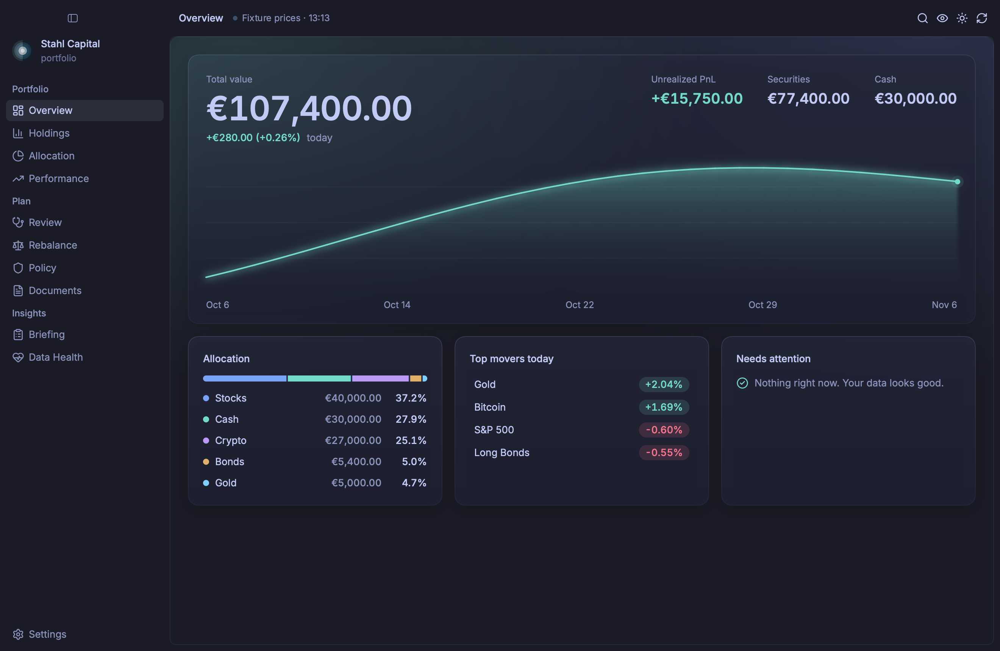
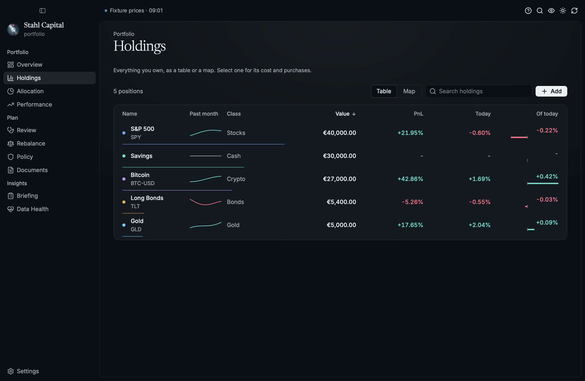
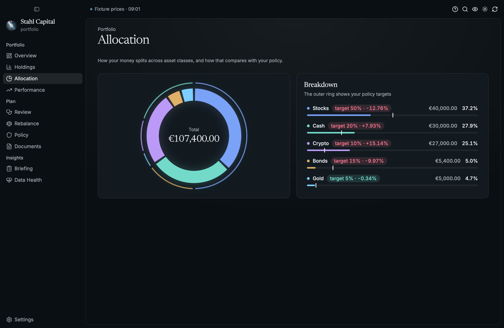
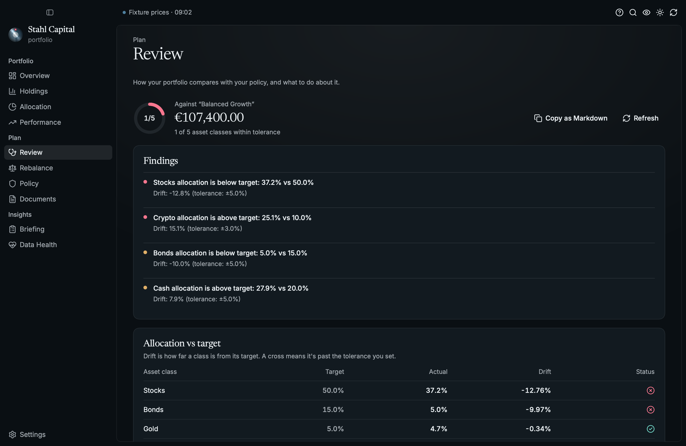
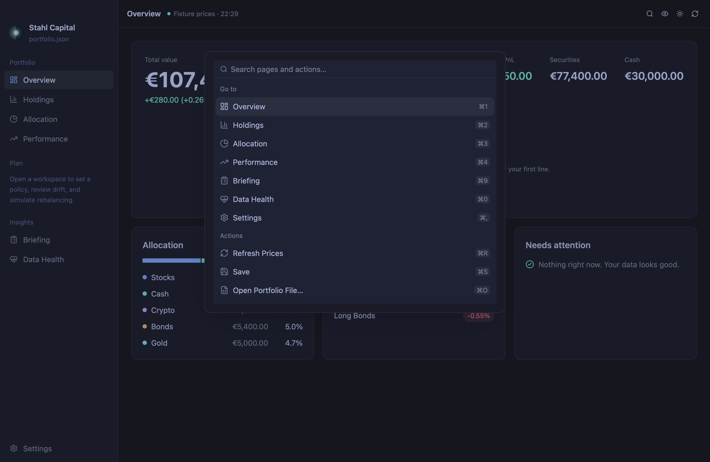

# Stahl Capital

[](https://github.com/MarkusZoppelt/stahl/actions/workflows/ci.yml)

A local-first, native desktop app for [`portfolio_rs`](https://github.com/MarkusZoppelt/portfolio_rs):
track investment portfolios, see how they got here, run policy-aware reviews, and simulate
rebalancing. Your data stays in plain files on your own machine. Built in Rust on
[Rune](https://github.com/anomalyco/rune), with no web view, for macOS, Linux, and Windows.



| | |
|---|---|
|  |  |
|  |  |

> **Status:** early. Expect rough edges.

## Features

- **Overview:** total value, today's change, and value over time at a glance, with what needs attention
- **Holdings:** a sortable, searchable table with a detail pane for cost basis and purchases
- **Allocation:** the split today, compared with your policy's targets
- **Performance:** value over time with time-weighted return, separating market moves from money you added
- **Review** (workspace): drift, constraint checks, data quality, and suggested actions
- **Rebalance** (workspace): what-if scenarios. It never trades.
- **Policy** (workspace): your machine-readable investment policy, in an editor with a readable summary
- **Documents** (workspace): weekly reports and decision records
- **Briefing:** the summary an advisor would ask for, with Copy as Markdown to hand it to an AI assistant
- **Data Health:** file validation, data-quality findings, and workspace checks

And it behaves like a desktop app:

- **Command palette** (`⌘K`) that also finds your holdings, and shortcuts for every page (`⌘1`–`⌘0`).
  Ctrl stands in for `⌘` on Linux and Windows.
- **Hide amounts** (`⌘⇧H`) before you share your screen
- **Drop a file or folder** on the window to open it (not yet on Wayland, where Rune gets no drags)
- **Unsaved changes** show in the title bar, and quitting offers to save them
- **A broken positions file** shows the line and column at fault. It is never shown as an empty portfolio, and never overwritten.
- **Price freshness** in the toolbar: live, stale, partial, or offline
- **Motion that means something:** digits roll when a price changes, the hero flashes when new
  prices land, charts draw themselves in and read out the value under the pointer, and rows fly
  between Overview and the page they belong to. All of it respects the system's reduced-motion
  setting.
- **Figures you can read at a glance:** one colour per asset class on every page, your policy's
  targets as an outer ring around the allocation donut, each holding's weight along its row, a gauge
  for how much of the portfolio sits within policy, and today against afterwards for a rebalance.
- **Prices catch up** when you come back to the app after 15 minutes away
- **Updates** you decide on: it tells you when a new version is out, and installs it only when you
  say so. See [Updates](#updates).
- Light and dark themes, and system file panels. On macOS, native menus, context menus, a Dock
  menu, and saved reports you can drag out to Finder or Mail.

### History

To chart your portfolio over time, Stahl records one valuation per day when it opens a portfolio or
refreshes prices, if every position has a price. It uses the same files as `portfolio_rs snapshot`,
so both add to one history:

- in a workspace, `portfolio/history/main/snapshots.jsonl`
- otherwise, `$XDG_DATA_HOME/portfolio_rs/main/snapshots.jsonl` (or under `~/.local/share`)
- anywhere you like, with `PORTFOLIO_RS_DATA_DIR`

Encrypted (`.gpg`) portfolios are never recorded, because that would put their values on disk in
plaintext.

## Run

```sh
nix run github:MarkusZoppelt/stahl
```

Pass a positions file to open it: `stahl positions.json`.

## Install

```sh
nix profile install github:MarkusZoppelt/stahl
```

Installers (`.dmg`, `.deb`, and a Windows `.zip`) are attached to
[GitHub Releases](https://github.com/MarkusZoppelt/stahl/releases).

## Updates

On launch, Stahl asks GitHub whether there is a newer release. That is one request to
`api.github.com`. GitHub sees your IP address and which version of Stahl is asking, and nothing about
your portfolio. If it can't get an answer it says nothing. If there is a newer version, a notice offers its release notes, and nothing is downloaded
until you press the button. You can also use **Check for Updates…** in the command palette, in
Settings, or in the app menu on macOS. Drafts, prereleases, and older versions are never offered.

Set `STAHL_NO_UPDATE_CHECK=1` to skip the check on launch. Checking by hand still works.

What installing means depends on how you installed Stahl:

| Installed from | What an update does |
|---|---|
| **macOS `.dmg`** (Apple Silicon) | Replaces the app in place, then restarts when you say so |
| **Windows `.zip`** | Replaces `stahl.exe` in place, then restarts when you say so |
| **Debian `.deb`** | Downloads and verifies the package, saves it to your downloads, and gives you the `sudo apt install` command. Stahl never asks for root |
| **Nix** | Only tells you, and links to the release. The Nix store is read-only and belongs to Nix, so update it the way you installed it |
| **Anything else** (a source build, Intel Mac, ARM Linux, or an app still running from the disk image) | Only tells you, links to the release, and says why |

If an update can't finish, the version you have stays as it was, and restarting saves your changes
first.

**What is and isn't verified.** Downloads are HTTPS-only, from this repository's releases, and must
match the SHA-256 checksum published beside the installer. That catches a corrupt or truncated
download. It doesn't catch a compromised release, since whoever could replace an installer could
replace its checksum too. The app isn't signed with a Developer ID or notarized either: macOS builds
are ad-hoc signed, and an update is not quarantined, so Gatekeeper doesn't review it the way it does
a first install from a browser. If that matters to you, verify and install releases yourself, or use Nix.

## Building

### With Nix (recommended)

```sh
nix build .#stahl      # ./result/bin/stahl
nix run .#stahl        # build + run
nix develop            # the pinned Rust toolchain and everything else
cargo run
```

### Without Nix

Requires [rustup](https://rustup.rs), which picks up the toolchain pinned in `rust-toolchain.toml`.
On Linux you also need the development packages for xkbcommon and Wayland
(`libxkbcommon-dev libwayland-dev` on Debian and Ubuntu), and `libxkbcommon-x11-0` plus a Vulkan
driver to run it. On macOS the Xcode command line tools are enough.

```sh
cargo run
```

## Development

```sh
cargo test
cargo run --example demo                                        # a made-up portfolio, no network
cargo run --example demo -- --list-scenes
cargo run --example demo -- --snap out.png --scene holdings --at 2   # any screen, no window
```

`tests/e2e.rs` drives the real views and handlers in Rune's headless runtime, with clicks, keys and
shortcuts, on real `portfolio_rs` data and fixture quotes. To try the app itself without the
network, set `PORTFOLIO_RS_QUOTES=offline` or `fixture:<path>`.

`nix flake check` runs the release build, `cargo clippy --deny warnings`, `cargo fmt --check`, and
all the tests. `nix fmt` formats the Nix code. CI (`.github/workflows/ci.yml`) runs it on Linux and
macOS for every push and pull request. It also runs clippy and the tests with plain cargo on Linux,
macOS, and Windows, renders the screens with the real renderer (the images are attached to the run),
and opens a real window.

## Releases

To release, bump the version in `Cargo.toml`, merge it, and push a matching tag (`v0.2.0` for version
`0.2.0`). `.github/workflows/release.yml` then builds installers with each OS's native toolchain and
publishes a GitHub Release with them and their `.sha256` checksums, once all three have built. The
in-app updater needs those exact asset names (see `src/update.rs`) and won't install without a
checksum. This is
separate from Nix: `nix build` produces binaries linked against `/nix/store` paths, which is fine for
machines with Nix but not for distribution. macOS builds are ad-hoc signed, as there is no Apple
Developer certificate configured, so users need to right-click → Open (or clear the quarantine
attribute) on first launch.

## Project structure

```
src/backend.rs   The bridge to portfolio_rs, which runs on Tokio beside Rune
src/state.rs     All state, and everything that changes it
src/update.rs    Finding, verifying, and installing new releases
src/app.rs       Window chrome, menus, and how it starts
src/view/        Pure functions from state to elements, one module per area
src/theme.rs     Tokyo Night, dark and light
src/icons.rs     Lucide icons
src/demo.rs      The made-up portfolio for the tests and the demo
examples/demo.rs The demo, and a named scene for every screen
assets/          App icons
tests/e2e.rs     End-to-end tests on the real UI
flake.nix        Reproducible build for macOS, Linux, and NixOS
```

Almost all domain logic (portfolio math, policy review, simulation, reports) lives in the
`portfolio_rs` library.

## License

MIT — see [LICENSE](LICENSE).
