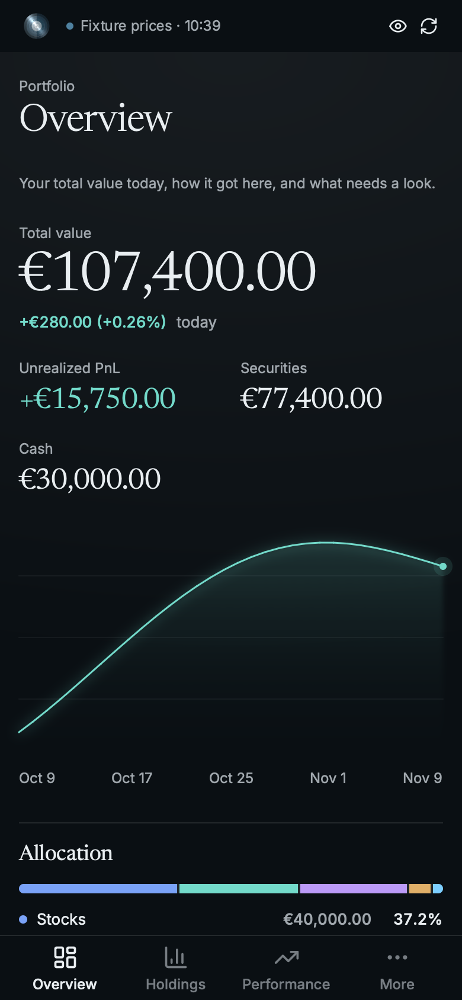
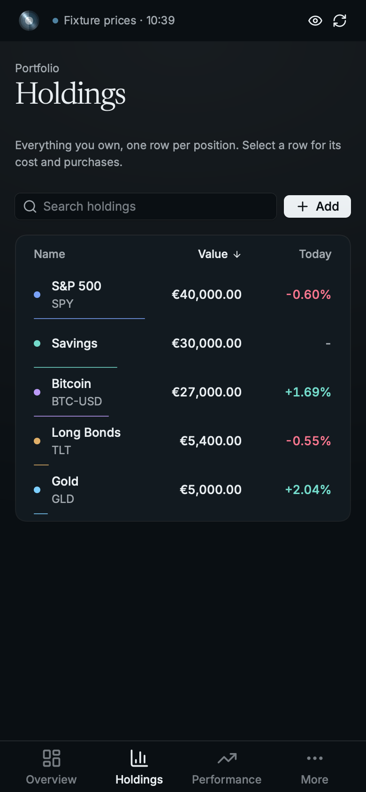
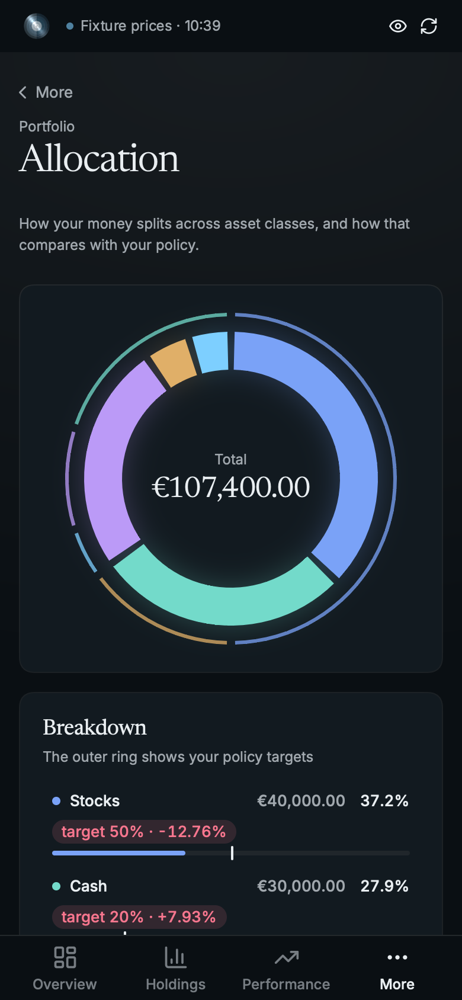

# Stahl on iPhone and iPad

The same app as the desktop: `rust/` is a static library that runs Stahl's own `State` and views
on a Rune `LayerHost`, and `Shell/` is the small UIKit app around it (window, display link, touch,
keyboard, trackpad, Face ID, the document picker). A phone gets its own layout. An iPad gets the
desktop one unless it's in a narrow split view.

| | | |
|---|---|---|
|  |  |  |

`rust/` is its own Cargo workspace with its own lockfile. Keep its Rune `rev` the same as the app's.

## Simulator

Needs Xcode. The flake's `ios` shell has the Rust targets:

```sh
nix develop .#ios -c ios/build-sim.sh --run [--device "iPad Air 11-inch (M4)"] [--release]
```

It opens your real portfolio with live prices. To open the demo instead, launch it with
`SIMCTL_CHILD_STAHL_IOS_DEMO=1`.

`simctl` can't tap, so the shell plays input from `STAHL_IOS_SCRIPT` (see `play` in
`Shell/App.swift`: `wait`, `tap`, `drag`, `type`, `key`, `pick <path>` and a few more):

```sh
SIMCTL_CHILD_STAHL_IOS_SCRIPT="wait 2; tap 346 755" xcrun simctl launch booted net.zoppelt.stahl
```

To find where to tap, dump a scene's layout at the simulator's view size (402x778 on an iPhone 18
Pro) and look up the bounds:

```sh
cargo run --example demo -- --tree /tmp/tree.json --scene phone-holdings --size 402x778
```

The simulator fakes Face ID through `simctl spawn booted notifyutil`: enrol with
`-s com.apple.BiometricKit.enrollmentChanged 1` then `-p` the same name, and match with
`-p com.apple.BiometricKit_Sim.pearl.match`.

## A real device

Run this outside the dev shell, with Xcode signed in to your team and the device unlocked and in
Developer Mode. Xcode only signs; the project is generated from `project.yml`.

```sh
ios/install-device.sh <device name or UDID> <team id> [bundle id]
```

A bundle id belongs to one team, so pass your own if you're not on the default one.

## What's different from the desktop

- No self-updates and no file drops. Files come through UIKit's document picker
  (`Shell/Documents.swift`), which keeps a bookmark so the last portfolio reopens.
- Config and single-file history live in the app's `Library/Application Support`. A workspace
  keeps its own.
- The shell copies to the system pasteboard for the app, saves unsaved edits when the app goes to
  the background, refreshes stale prices when it comes back, plays haptics, hides the app behind
  the vault door in the app switcher, and hides amounts on a shake. With the lock on, Face ID
  opens it.
- Pull down past the top of a page to refresh, slide a holding's row open on a phone, and swipe
  from the left edge to go back.

The icon, with its dark and tinted versions, comes from `site/render-icons.sh`.
